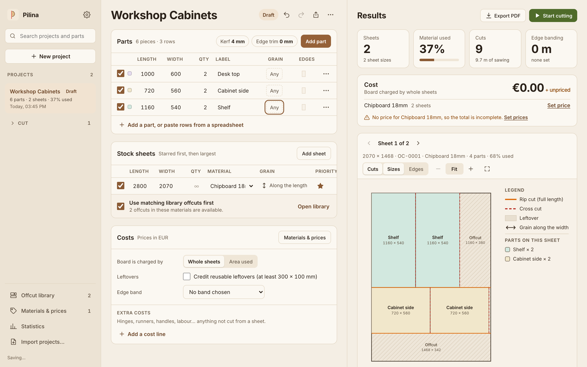
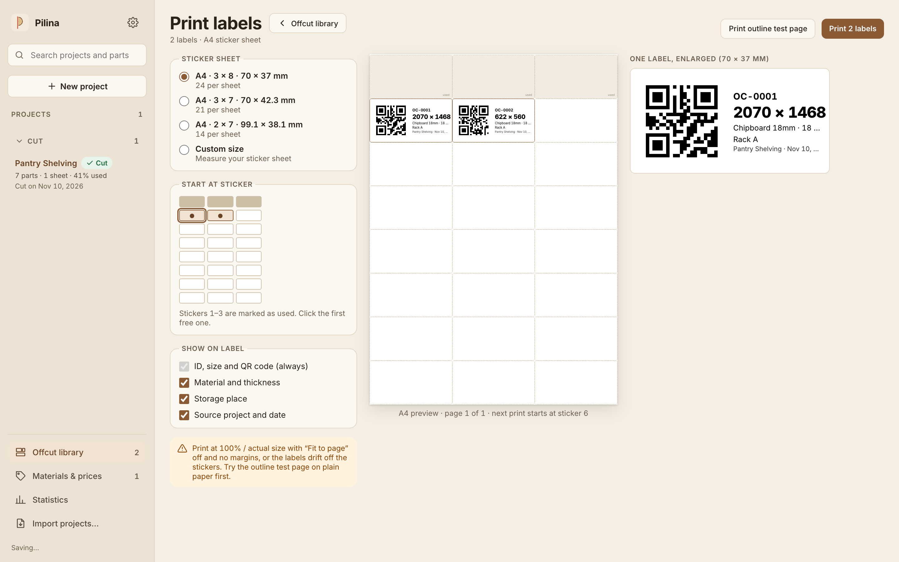
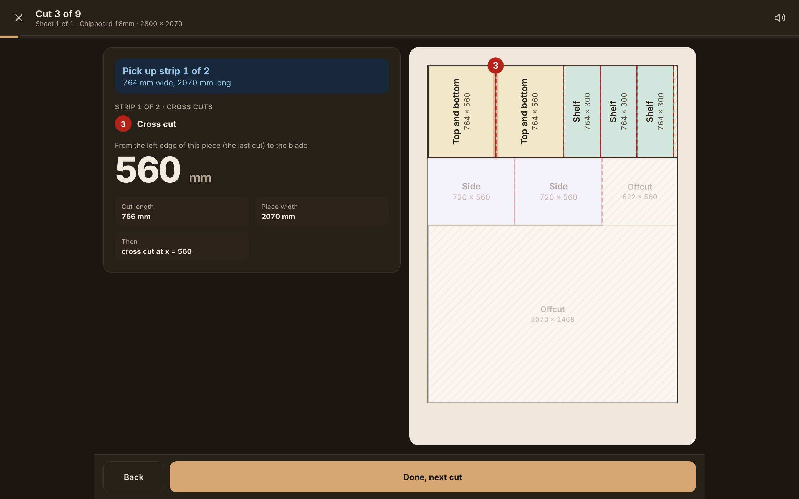
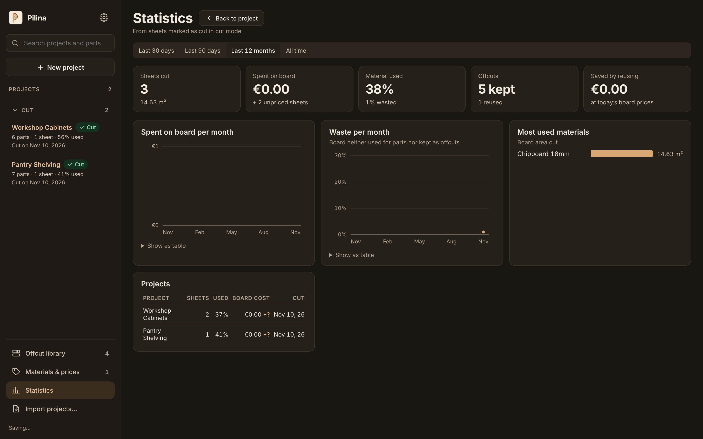

# Pilina

**Cut plans, step-by-step sawing, and automatic offcut management for sheet-goods workshops.**

*Pilina* is the Slovak and Czech word for a single grain of sawdust — the smallest thing a cut leaves behind.

Most sheet-cutting calculators stop the moment a layout is drawn: leftover pieces get leaned against a workshop wall, forgotten because nobody remembers their exact dimensions or material, and eventually thrown out while you buy fresh full boards for the next job.

**Pilina closes the workshop offcut loop.** It plans guillotine cuts for plywood, MDF, melamine, and veneered boards, guides you through every cut at the saw, labels your usable leftovers with QR stickers, and **automatically reuses those saved offcuts first** on future projects — shrinking your scrap pile and saving money on sheet goods.



---

## Why Woodworkers & Workshops Use Pilina

### 1. Automatic Offcut Management, QR Labels & Reuse
Stop letting usable offcuts pile up in the corner of the shop:
- **Automatic leftover capture:** When you finish cutting a sheet, Pilina automatically highlights every leftover piece large enough to keep (above your minimum keepable size) and lets you save them to your **Offcut Library** in one tap.
- **Unique IDs & storage locations:** Each saved offcut gets a permanent code (`OC-0001`, `OC-0002`, …), material & grain metadata, and a workshop storage location (`Rack A`, `Bin 1`, `Wall shelf`).
- **A4 QR sticker labels (even on partly-used sheets):** Print scannable QR stickers on standard A4 label sheets (`3 × 8 · 70 × 37 mm`, `2 × 7`, `2 × 4`, or custom dimensions). Click the first remaining sticker on a partially-peeled sheet so you never waste sticker paper.
- **Self-contained QR codes:** Scan any board's sticker with your phone or tablet camera (or a USB barcode scanner) to jump straight to that offcut — or import it onto another device even without a shared database.
- **Automatic priority reuse:** Whenever a new project uses a matching material, Pilina automatically checks your Offcut Library and schedules your existing offcuts **before** allocating any new full sheets (with zero outer trim on already-clean sawn edges).



### 2. Step-by-Step Cut Mode Built for Real Saws
Take your phone, tablet, or laptop right to the saw:
- **Matches your workshop setup:** Choose **Rips first** (rip all strips with a track/plunge saw, then cross-cut every strip on a mitre saw) or **Strip by strip** (finish each strip completely before ripping the next on a panel or table saw).
- **Real fence measurements:** Every step tells you the exact fence or stop-block distance measured from the **last cut edge** of the current piece — plus which strip to pick up next (`Pick up strip 1 of 2`).
- **Hands-free & workshop-friendly:** Large touch targets, keyboard navigation (`Space` / arrow keys), optional spoken voice readouts for each cut, and high-contrast **Light and Dark themes** while keeping the sheet diagram on crisp, readable paper.



### 3. Material Library, Edge Banding & True Project Costing
- **Multi-material projects:** Assign different materials (e.g., `Birch plywood 18 mm` for carcasses, `White HDF 3 mm` for backs, `Oak veneer 19 mm` for fronts) within a single project; Pilina optimizes each material into its own set of sheets.
- **Grain direction & edge banding:** Lock grain direction along length or width, or allow rotation. Mark edge banding on any of the four sides (`L1`, `L2`, `W1`, `W2`) with an optional cutting allowance so parts are sawn slightly smaller and finish at exact size once banded.
- **Honest board pricing:** Price boards by the whole sheet, by area used, or **whole sheet minus credit for kept offcuts** — plus edge-banding metre costs, hardware extras (hinges, slides, screws), and VAT/tax.
- **Printable A4 Workshop PDF:** Export a clean vector PDF with a project summary, per-part cutting checklist with visual grain/edge-banding silhouettes, full-page sheet diagrams, and numbered cut lists.

### 4. Workshop Statistics & Savings Tracking
Every sheet you finish in Cut Mode feeds into your workshop statistics:
- Track **sheets cut**, **total board spend**, **material utilization vs. waste %**, **offcuts kept vs. reused**, and the exact **money saved by reusing offcuts** at current board prices.



### 5. Metric & Imperial Units · Available in 41 Languages
- **Millimetres, centimetres, and fractional inches:** Switch seamlessly between `mm`, `cm`, and inches — type workshop fractions naturally (`23 5/8"`, `2' 11 1/2"`, or `762 mm`).
- **Available in 41 languages, including Asian languages:** Full interface localization across European, Middle Eastern, and Asian languages (including English, Slovak, Czech, German, French, Spanish, Italian, Polish, Ukrainian, Turkish, Arabic, Hindi, Japanese, Korean, Simplified & Traditional Chinese, Vietnamese, Thai, Indonesian, and more).

### 6. Local-First, Offline & Private
- **Works anywhere, with no account or server:** Runs in any modern browser, installs as an offline **Progressive Web App (PWA)** on desktop and mobile, and packages as a native **macOS app**.
- **Easy multi-device sync:** Share projects via a compact URL / QR code, export `.pilina.json` backups, or point Pilina at a shared folder in **iCloud Drive, Google Drive, OneDrive, or Dropbox** to keep projects, materials, and your offcut inventory automatically synced between your office computer and your workshop phone or tablet.

---

## Development & Building

Under the hood, Pilina combines a deterministic Rust guillotine cutting engine (compiled to WebAssembly and a native CLI) with a React + TypeScript + Vite web app and a Tauri macOS shell. See [PLAN.md](PLAN.md) for architecture and milestones.

```text
crates/pilina-core   optimizer, pricing, statistics (pure Rust)
crates/pilina-wasm   WebAssembly bindings used by the web app
crates/pilina-cli    `pilina job.json` → plan JSON
web/                 React + TypeScript + Vite PWA
desktop/             Tauri shell: standalone desktop app (macOS, Windows, Linux)
```

### Prerequisites
- Rust (stable) with the `wasm32-unknown-unknown` target, plus `wasm-pack`
- Node.js 22+
- For the desktop app: Xcode Command Line Tools on macOS (`xcode-select --install`), Visual Studio C++ Build Tools on Windows, or WebKitGTK packages on Linux

### Commands

```bash
# Rust cutting engine & CLI
cargo test --workspace --release                        # engine tests (property tests run 256 random jobs)
PROPTEST_CASES=10000 cargo test --release               # …or many more
cargo clippy --workspace --all-targets                  # engine lint
cargo bench -p pilina-core                              # benchmarks
cargo run --release -p pilina-cli -- job.json           # optimize a job file, print the plan
cargo run --release -p pilina-cli -- --stats job.json   # one-line summary instead

# Web app & PWA
cd web
npm install
npm run dev          # builds the engine to WASM, then starts Vite
npm test             # unit tests
npx playwright install chromium   # once: install browser for end-to-end tests & screenshots
npm run e2e          # end-to-end tests in Chromium, desktop and phone sizes (server on :5174)
npm run e2e:ui       # …the same, in Playwright's interactive window
npm run screenshots  # capture real Light & Dark mode screenshots into ../docs/screenshots/
npm run lint
npm run build        # production build (PWA) in web/dist
```

### Desktop App (macOS, Windows, Linux)

Prebuilt binaries are available on the [**GitHub Releases**](https://github.com/grafffooo/pilina/releases) page:
- **macOS:** Universal `.dmg` (runs on both Apple Silicon M1/M2/M3/M4 and Intel)
- **Windows:** `.exe` installer (NSIS setup)
- **Linux:** `.AppImage` and `.deb`

To build the desktop app locally:

```bash
cd web
npm run app        # builds the web frontend and bundles native desktop packages
npm run app:dev    # development: opens the native window on the Vite dev server with live reload
```

The desktop app wraps the web app in a native window (Tauri) with no external server. Project files use the native Save dialog and sticker sheets print directly through the native print panel.
